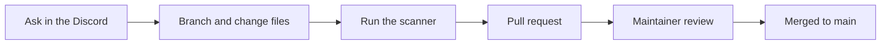

# StackPack on GitHub

The public side of StackPack: the small tools we build, and the things members ask for that are worth keeping out of the chat.

**In plain words:** StackPack is a community where people ask for help building things. Conversation happens in the Discord. When a request turns into a file that anyone can read, reuse or improve, it is saved in this repository. For example, a member asks for a prompt that writes a weekly status note. The assistant writes the prompt, checks it with the security scanner, and saves it in the member's own repo here.

| | |
|---|---|
| Status | Live: the security scanner in `tools/` and the member repos saved here. Nothing in this repository is deployed. |
| Owner | Repo owner role; approves changes: ARC operations role |
| Runs at | Nothing runs from here. The scanner runs on any computer that has the repo, and `.github/workflows/security.yml` runs it on GitHub when Actions is on. |
| A change goes live by | Merging to `main`. There is no deploy step; details in [CONTRIBUTING.md](CONTRIBUTING.md#release-and-rollback) |
| Change something | Start with [CONTRIBUTING.md](CONTRIBUTING.md) |

## What this repository is

The repository holds three kinds of thing:

- **Tools we run.** Small, plain utilities, each with its own page. The first one is the security scanner in [tools/](tools/). It checks files before they are saved here.
- **The rules of this home.** Who may do what is in [MANAGEMENT.md](MANAGEMENT.md). How to send a change is in [CONTRIBUTING.md](CONTRIBUTING.md).
- **Member work.** Repos named after the member they were built for. Each holds the prompts, scripts and notes that member asked for.

Conversation does not happen here. The Discord is where people ask, and this repository is where the answer is kept.

## What this repository is not

- **Not the classroom.** The lessons, workshops and community feed live in the Skool group at [skool.com/stackpack](https://www.skool.com/stackpack/about). Members keep them there.
- **Not a place for client or employer work.** Anything about a client's or an employer's private work stays out.
- **Not a place for secrets.** Passwords, keys and personal details do not belong in a file or a commit. The scanner refuses the common shapes.

## Who uses it

| Who or where | What they use it for | How they get it |
|---|---|---|
| Community members | Reading, reusing and improving the tools and guides | Browsing this repository, or forking a public repo |
| Members with a repo of their own | Prompts, scripts and notes built for them | The assistant saves them in their repo after a check |
| The community's assistant | Writing files, running the scanner, saving work | Write access, with a pull request review |
| Repo maintainers | Reviewing and merging changes | Named in [MANAGEMENT.md](MANAGEMENT.md) |

The public website is [stackpack.app](https://stackpack.app). It carries the brief and the community rules.

## How a change reaches this repository

1. Ask in the StackPack Discord. Say what you want and what finished looks like.
2. The assistant, or a member with GitHub access, makes a branch and changes the files.
3. The scanner runs on the changed files: `python3 tools/secret_scan.py --path .`
4. A pull request is opened with the template filled in.
5. A maintainer reviews it and merges it to `main`.

A change counts as done when it is merged to `main` and the scanner passed on the merged files. Nothing is deployed after the merge.



## Start here

| You want to | Go to |
|---|---|
| Send a change to this repository | [CONTRIBUTING.md](CONTRIBUTING.md) |
| Understand who may do what | [MANAGEMENT.md](MANAGEMENT.md) |
| Check a file for keys or dangerous patterns | `python3 tools/secret_scan.py --path <file or folder>` (see [tools/README.md](tools/README.md)) |
| Read the scanner's promises and limits | [tools/README.md](tools/README.md) |
| Ask for something to be built | Post it in the StackPack Discord |

## What is inside

| Folder | What it holds |
|---|---|
| `tools/` | Small utilities. Each has its own page in `tools/README.md`. |
| `assets/` | The images used on this page and in the diagrams. |
| `ISSUE_TEMPLATE/` | Forms for reporting a broken step and for proposing a project. |
| `.github/` | The pull request template and the security workflow file. |
| `archive/` | Superseded files, kept for history. |

The root files are [README.md](README.md) (this page), [CONTRIBUTING.md](CONTRIBUTING.md) (how to send a change), [MANAGEMENT.md](MANAGEMENT.md) (who does what), [AGENTS.md](AGENTS.md) and [CLAUDE.md](CLAUDE.md) (instructions for AI agents).

## How it fits

This repository is one of the places the community's work ends up.

- The Discord is where requests start.
- The Skool group is where lessons and workshops live.
- The website at [stackpack.app](https://stackpack.app) points people to both.
- The [stackpack-project-template](https://github.com/arc-web/stackpack-project-template) repo starts a new project with the scanner switched on.

Each member repo gets the same scanner check before anything is saved in it.

## Tools

Every tool has its own page that says what it does, how to run it and what it does not promise.

- [secret_scan.py](tools/secret_scan.py): refuses keys, private key blocks and dangerous patterns before a file is admitted. Its page is [tools/README.md](tools/README.md).

## The security scan

The scanner is a gate, not a guarantee. A pass does not mean a file is safe, because the scanner recognises shapes, not intentions. Run it before you hand over any change:

```bash
python3 tools/secret_scan.py --path .
```

Exit code 0 means nothing high was found. Exit code 1 means something high was found, and the file must not be admitted until it is fixed. Exit code 2 means the call was wrong and nothing was scanned.

The workflow file `.github/workflows/security.yml` runs the same command on every push and pull request. Whether GitHub Actions is switched on for this repository is a setting, not something this page can show.

## Words we use

- **Member repo:** a repository named after one member, holding the work built for them.
- **Maintainer:** a person or agent allowed to review and merge changes to `main`. The roles are listed in [MANAGEMENT.md](MANAGEMENT.md).
- **Scanner:** the `secret_scan.py` tool in `tools/`.
- **Admit a file:** save it in a repo after the scanner passed.

## Sending a change

Read [CONTRIBUTING.md](CONTRIBUTING.md). It explains the short path for anyone, with or without an organisation account, and the path for people who already have write access.

## House rules

The same as the Discord. Be decent, credit people, no client's private work, no spam.

## Help

Ask in the StackPack Discord. Say which repo or file you mean, and what you saw.

> [!NOTE]
> Working with an AI agent? Its instructions are in [AGENTS.md](AGENTS.md) and [CLAUDE.md](CLAUDE.md).
